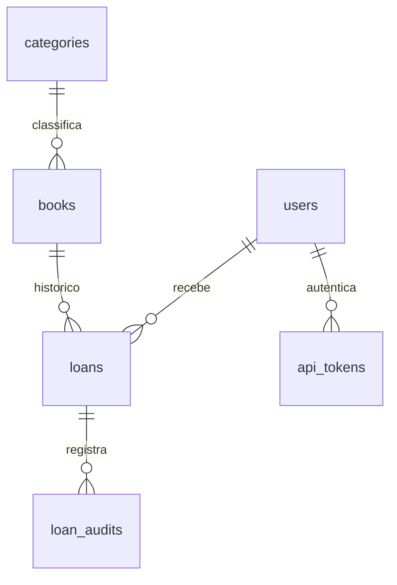

# Arquitetura e regras

Cada book é um exemplar físico com code único. Autor continua texto para evitar uma entidade redundante. Uma pessoa pode ter até três empréstimos ativos. Um exemplar só pode ter um ativo. Prazo não pode preceder retirada; devolução não pode preceder retirada ou estar no futuro. Atraso é calculado pelo prazo e pela ausência de devolução, sem estado duplicado no banco.

`consulta` é o leitor existente: consulta acervo e somente seus empréstimos. Admin e bibliotecário registram/devolvem empréstimos; apenas admin exclui livros sem histórico e gerencia categorias. Não existe administração de outras contas; isso preserva o escopo anterior. Cadastro público e perfil não aceitam role. Histórico não pode ser excluído; empréstimos não têm CRUD destrutivo nem troca de tomador/exemplar. A atualização permitida é a devolução.

Fluxo: rota → middleware auth/token → Controller/Policy/Form Request → Service → SQL parametrizado/transação → resposta Blade/Resource. BookService protege histórico e estado ao editar/excluir. LoanService chama `SELECT fn_quantidade_emprestimos_ativos`, `CALL sp_registrar_emprestimo` e `CALL sp_registrar_devolucao`. As procedures não fazem COMMIT/ROLLBACK internos: participam da transação Laravel.

As triggers validam qualquer cliente SQL, auditam INSERT/UPDATE e sincronizam a situação do exemplar. Locks de usuário e livro serializam verificações de limite/disponibilidade; índice único parcial impede dois empréstimos ativos do mesmo exemplar. Transações com deadlock podem ser repetidas até três vezes pelo Service. Funções de trigger são auxiliares, separadas das duas funções de negócio exigidas.

Índices adicionais: `books_title_order_idx(title,id)` atende ordenação/paginação; `loans_active_user_idx(user_id,due_at) WHERE returned_at IS NULL` atende contagem e consulta de ativos por pessoa. `loans_one_active_copy_idx` é proteção adicional e não conta como um dos dois índices de desempenho. A pesquisa `%termo%` não é acelerada pelo B-tree; não se promete ganho para tabelas pequenas. Consultas EXPLAIN em database/sql/02_demonstracao.sql.

Legado: exemplares já marcados emprestado, sem histórico, continuam indisponíveis para nova retirada. Um responsável deve reconciliar a situação após conferir o exemplar físico. Não são criados empréstimos ou dados pessoais fictícios para preencher lacunas. Seed usa firstOrCreate para não alterar a situação de exemplares existentes.

SQLite permanece útil para testes portáveis de auth/CRUD/API. Empréstimos exigem PostgreSQL; a suite específica não é substituída por testes SQLite.
